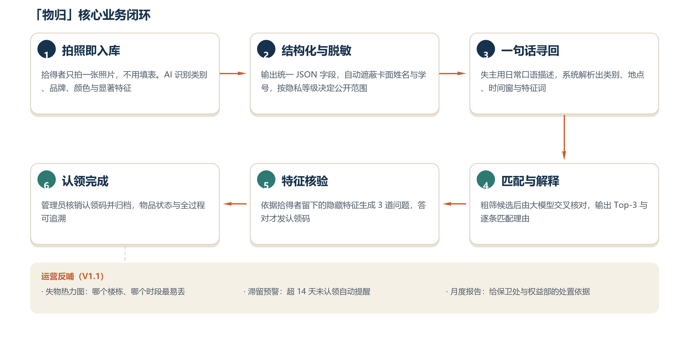
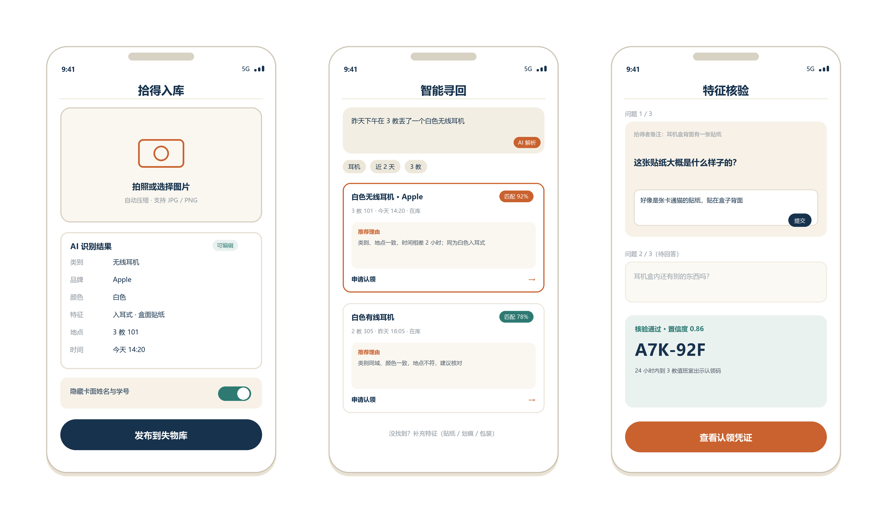

# 物归 · 校园失物智能招领

> 杭州电子科技大学　第二届 AIGC 应用创新大赛　·　赛题一：AI 辅助开发 · 创意产品原型

**拍一张照片，让失物自己找到主人。**

拾得者拍照即入库（多模态识别 + 结构化），失主一句话就能寻回（语义匹配 + 可解释理由），
认领前还要答对三道只有真失主才知道的问题（特征问答核验），管理端扫码核销、全程留痕。

---

## 在线演示

**<https://YOUR-NAME.github.io/guiwu/>** ← 部署后把这里换成你的地址

纯前端演示版：规则引擎跑在浏览器里，数据存在 `localStorage`，无需服务器、不会冷启动。
另有完整版（Python + SQLite + 可选真实模型）见下方「快速开始」。

## 为什么做这个

校园里丢一件东西，通常要失败三次：发在群里的消息两小时就被刷没了；捡到的人怕泄露信息不敢交；
值班室的登记本只写了一句“雨伞一把”。三个场景的失败点不同，底层原因却是同一个——
**失物信息始终以非结构化的形态存在，所以既不能被检索，也不能被匹配，更不能被追溯。**

我们缺的从来不是发布渠道，而是把一段口语、一张照片转成“可被匹配的结构”的那一步。



## 界面



> 图为设计稿。跑起原型后建议用自己的截图替换。

## 两种运行方式

| | 完整版 | 静态演示版 |
|---|---|---|
| 位置 | `app/` | `docs/` |
| 技术 | Python 3 标准库 + SQLite + 浏览器原生 JS | 同一套 UI + `web/engine.js` |
| 数据 | 服务端 SQLite | 浏览器 localStorage |
| 模型 | 可接千问-VL / Qwen-Max | 仅规则实现 |
| 适合 | 本地演示、录屏、接真实模型 | GitHub Pages 分享、评委随手点开 |

两者共用同一份界面源码，接口形状一致：页面里存在 `window.ENGINE` 就走浏览器引擎，否则走 HTTP。

### 快速开始（完整版）

```powershell
cd app
.\run.cmd
```

浏览器打开 <http://127.0.0.1:8000>（学生端）与 <http://127.0.0.1:8000/admin>（管理端）。

`run.cmd` 会自动寻找解释器；也可以用任意 Python 3.8+ 直接 `python server.py`。

**接真实模型**（可选）：

```powershell
$env:DASHSCOPE_API_KEY="sk-xxxx"
.\run.cmd
```

不配 Key 也能跑：识别、改写、精排、判分全部降级为规则实现，**断网也能演示完整闭环**。

### 重建静态站

```powershell
python build_web.py     # app/static + web/engine.js  ->  docs/
```

## 目录

```
app/                完整原型
  server.py         REST 接口（可平移至 FastAPI）
  core.py           SQLite、种子数据、口语改写、硬过滤、规则打分
  llm.py            模型网关 + 5 条提示词 + 规则兜底
  smoke.py          端到端冒烟测试（16 项）
  static/           学生端 / 管理端 / 样式
web/
  engine.js         浏览器端规则引擎（静态站使用）
  test_engine.js    Node 冒烟测试（14 项，校验与 Python 版结果一致）
docs/               静态站构建产物（GitHub Pages 指向这里）
figs/               图示与界面设计稿
build_*.py          图示、文档、PPT、脚本、静态站的生成脚本
```

## 交付材料

- `物归_项目文档.docx` — 32 页，9 章正文 + 附录 A—E（含 AI 使用说明与关键 Prompt）
- `物归_项目方案.pptx` — 19 页
- `物归_演示视频脚本.docx` — 11 个镜头，4 分 55 秒

## 测试

```powershell
python app/smoke.py               # 需先启动服务：16/16
node web/test_engine.js           # 浏览器引擎：14/14
```

两个版本对同一句查询给出相同的排序与分数（83.6% / 65.3%），这是刻意的：静态演示与录屏里的数字必须一致。

## 已知限制

1. 静态演示版没有视觉能力，`/api/parse` 返回示例字段并提示“已预填，请确认”。
2. 检索是「硬过滤 + 精排」两段式，没有向量召回；数据量到几百条以上需要补 embedding（V1.1）。
3. 规则判分用字符重合度近似语义等价，同义表达的容忍度不如真模型。

## 说明

本作品为课程竞赛参赛项目，版权归团队所有。文中测试数据均为团队自行构造，
不含任何真实师生的个人信息。
